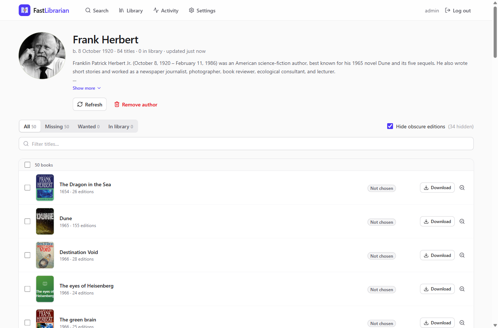
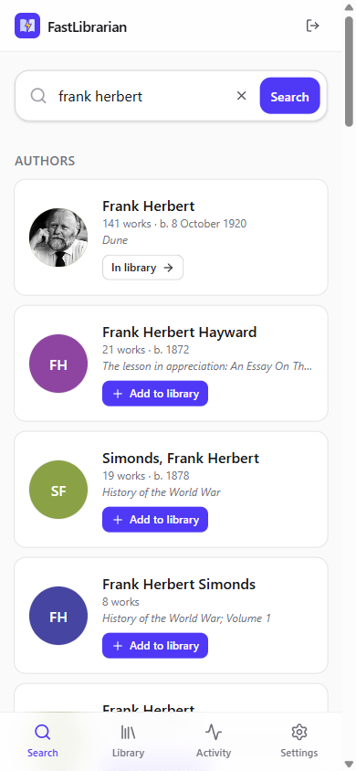

# FastLibrarian

A fast, simple ebook manager: a ground-up rewrite inspired by
[LazyLibrarian](https://gitlab.com/LazyLibrarian/LazyLibrarian), licensed GPL-3.0.

**What it does (v1, ebooks only):**

1. **Search** for a book, an author or an ISBN, all from one field.
2. **Add an author** to your library. Their bibliography is fetched in the background from
   OpenLibrary, cleaned of noise (calendars, box sets, magazines, duplicates) and refreshed daily.
3. **Pick the books you want.** FastLibrarian searches your indexers through **Prowlarr** and
   scores every release. The score breakdown is visible, so you can see why a release won.
   The best release goes to **qBittorrent**. When the download finishes, the ebook is copied into
   **Calibre-Web Automated**'s ingest folder.
4. FastLibrarian reads the Calibre library (read-only) and marks books you already have.

Nothing is downloaded unless you ask for it.

<p>
  
  
</p>

### Why a rewrite?

LazyLibrarian does a lot, but it does it slowly. It runs on CherryPy with a 10 000-line request
handler, it makes blocking API calls inside web requests, and it opens a new SQLite connection
for every query behind one global lock. Its fuzzy matching is spread across 19 files.
FastLibrarian keeps the part most people use (ebooks via torrents into Calibre) and does it with:

- an async API with background jobs, so the UI never waits on OpenLibrary or an indexer
- one matching module, tested on real release names
  (e.g. "Dune Messiah" never matches a search for "Dune")
- a modern, phone-friendly UI

## Prerequisites

FastLibrarian is **not** a standalone downloader. It is the "pick and fetch" piece in an
existing self-hosted media stack and relies on these services, which you install and run
yourself:

| Required | What for | Notes |
|---|---|---|
| **Docker** (with Docker Compose) | Runs FastLibrarian | Linux x86_64 tested. There is no prebuilt image yet; you build it locally (Node and Python are only needed inside the build). |
| **[Prowlarr](https://prowlarr.com/)** | Searches your indexers | Needs at least one **torrent** indexer with a Books category (7000 / 7020) enabled. FastLibrarian uses Prowlarr's API key; no "app sync" setup is needed. |
| **[qBittorrent](https://www.qbittorrent.org/)** (Web UI enabled) | Downloads the torrents | Web UI login, or the FastLibrarian container's subnet whitelisted under *Bypass authentication*. |
| **[Calibre-Web Automated](https://github.com/crocodilestick/Calibre-Web-Automated)** (CWA) | Imports finished ebooks into your Calibre library | FastLibrarian copies books into CWA's **ingest folder**, and reads CWA's **Calibre library** (`metadata.db`) to see what you already own. |
| Internet access to `openlibrary.org` | Book and author metadata | No account or API key needed. |

**Shared folders.** FastLibrarian has to see the same files as the other containers:

- the **download folder** qBittorrent saves to. Mount it at the same path in both containers;
  otherwise use the path mapping in Settings.
- CWA's **ingest folder**, read-write.
- CWA's **library folder**, read-only.

Run all of them with the same `PUID`/`PGID`, so CWA can read and delete the files FastLibrarian
writes.

**Not supported (yet):** Usenet/NZB, other torrent clients (Transmission, Deluge, …), a library
without CWA, and audiobooks. See the [roadmap](#roadmap).

FastLibrarian does not provide or point to any content. What you download through your own
indexers is your responsibility.

## Run with Docker

```sh
git clone https://github.com/olamellberg/fast-librarian.git
cd fast-librarian
docker build -t fastlibrarian:local .
```

Add the service to your compose file. Use
[`docker/docker-compose.example.yml`](docker/docker-compose.example.yml) as a template and
adjust the three volume paths, then run `docker compose up -d fastlibrarian`. Open
`http://<host>:8790`, create the admin account, then fill in **Settings**:

| Setting | Typical value |
|---|---|
| Prowlarr URL + API key | `http://prowlarr:9696`, from Prowlarr → Settings → General |
| qBittorrent URL (+ login unless the subnet is whitelisted) | `http://qbittorrent:8080` |
| qBittorrent category | `books` |
| Ingest folder | `/cwa-book-ingest` (mount CWA's ingest dir here) |
| Calibre library | `/calibre-library` (mount CWA's library, `:ro` is fine) |

Each section has a **Test** button. If qBittorrent sees downloads under a different path than
FastLibrarian, set the path mapping (from → to). Mounting the same path in both containers is
simplest.

Environment variables: `PUID`/`PGID`/`UMASK` (file ownership), `FL_PORT` (default 8790),
`FL_LOG_LEVEL`, and `FL_AUTH_DISABLED=true` (only behind an auth proxy).

## Development

```sh
cd backend && uv sync && uv run pytest && uv run ruff check . && uv run mypy fastlibrarian
FL_CONFIG_DIR=./config uv run python -m fastlibrarian.main          # API on :8790
cd frontend && npm install && npm run dev                           # UI on :5173, proxies /api
```

Architecture: FastAPI + SQLAlchemy (async, SQLite/WAL, Alembic), with a persistent job queue for
all background work, and a React + Vite + TanStack Query frontend served from the same container.

## Roadmap

- [x] v1: ebooks via Prowlarr (torrents) → qBittorrent → Calibre-Web Automated
- [ ] Sorting/filters in the library view
- [ ] Automatic search for wanted books
- [ ] Usenet (Newznab + SABnzbd/NZBGet), more torrent clients
- [ ] Audiobooks (e.g. → Audiobookshelf)
- [ ] OPDS feed and notifications (Apprise)
- [ ] Published images (GHCR)

## License

GPL-3.0-or-later. FastLibrarian is inspired by LazyLibrarian (also GPL-3.0) and is not
affiliated with it.
